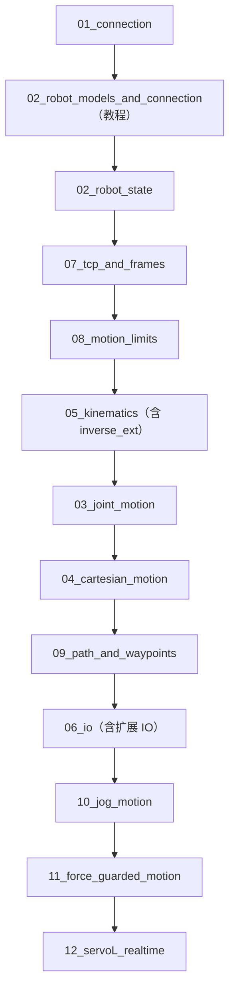

# Diana API C++ Examples

[English](README.md) | [中文](README.cn.md)

面向 **Diana / Thor 系列机器人**客户的 C++ API 入门教程与可运行例程。

目标：客户下载仓库后，放入官方 Diana C/C++ SDK，选择机器人型号并传入 IP，即可从连接、状态读取开始逐步学习常用 API。

> 本仓库不重新封装一套机器人 SDK。`examples/` 尽量直接调用原始 Diana API；`common/` 只放参数解析、回调、等待、打印和型号校验等公共辅助代码。

## 1. 支持型号

```text
Diana series (7 axes)
├── Diana3       -> --model diana3
├── Diana7       -> --model diana7
└── Diana7 G2    -> --model diana7-g2

Thor series (6 axes)
├── Thor7        -> --model thor7
├── Thor12       -> --model thor12
└── Thor20       -> --model thor20
```

所有型号共用同一套 examples。型号差异集中在 [`robots/`](robots/) 中，连接后通过 `getJointCount()` 校验 7 轴 Diana / 6 轴 Thor。

> Thor7 Pro profile 暂时未注册，当前不能通过 `--model thor7-pro` 选择。

详细说明见 [`docs/02_robot_models_and_connection.cn.md`](docs/02_robot_models_and_connection.cn.md)。

## 学习教程（建议按顺序阅读）

新用户请务必按以下顺序学习。教程从连接与状态读取逐步进入运动和高级控制；请先完成前面的只读验证，再使用会写 I/O 或会产生运动的例程。

- [01 快速开始](docs/01_getting_started.cn.md)
- [02 机器人型号与连接](docs/02_robot_models_and_connection.cn.md)
- [03 机器人状态、错误与诊断](docs/03_robot_state_and_diagnostics.cn.md)
- [04 坐标系、位姿与旋转](docs/04_coordinate_pose_and_rotation.cn.md)
- [05 关节运动](docs/05_joint_motion.cn.md)
- [06 笛卡尔运动](docs/06_cartesian_motion.cn.md)
- [07 I/O](docs/07_io.cn.md)
- [08 TCP、坐标系与负载](docs/08_tcp_frames_and_payload.cn.md)
- [09 运动限制](docs/09_motion_limits.cn.md)
- [10 路径与路点](docs/10_path_and_waypoints.cn.md)
- [11 安全](docs/11_safety.cn.md)
- [12 高级运动](docs/12_advanced_motion.cn.md)

教程负责解释“为什么、什么时候、怎么用”；下面的例程负责展示对应的可运行 C++ 代码。

- [Ubuntu 18.04 / 20.04 / 22.04 平台兼容性测试](docs/platform_compatibility_test.cn.md)

## 运行例程

以下链接说明每个可执行例程的命令、参数与使用注意事项。

- [01 连接与型号识别](examples/01_connection/README.cn.md)
- [02 机器人状态与诊断](examples/02_robot_state/README.cn.md)
- [03 关节运动](examples/03_joint_motion/README.cn.md)
- [04 笛卡尔运动](examples/04_cartesian_motion/README.cn.md)
- [05 运动学](examples/05_kinematics/README.cn.md)
- [06 I/O](examples/06_io/README.cn.md)
- [07 TCP、坐标系与负载](examples/07_tcp_and_frames/README.cn.md)
- [08 运动限制](examples/08_motion_limits/README.cn.md)
- [09 路径与路点](examples/09_path_and_waypoints/README.cn.md)
- [10 点动运动](examples/10_jog_motion/README.cn.md)
- [11 力阈值停止](examples/11_force_guarded_motion/README.cn.md)
- [12 ServoL 实时下发](examples/12_servoL_realtime/README.cn.md)

### 例程功能概览

涉及写入或运动的例程，请先完成相应教程并阅读安全说明。

| 例程 | 说明 | 默认是否运动 |
|---|---|---|
| [`01_connection`](examples/01_connection/README.cn.md) | 连接、版本、型号/轴数识别、状态、可选上使能/下使能 | 否 |
| [`02_robot_state`](examples/02_robot_state/README.cn.md) | 状态、外力、链路、错误/警告与碰撞诊断 | 否，只读 |
| [`03_joint_motion`](examples/03_joint_motion/README.cn.md) | `moveJToTarget` 关节运动 | 否，需 `--run` |
| [`04_cartesian_motion`](examples/04_cartesian_motion/README.cn.md) | `moveLToPose` 笛卡尔直线运动 | 否，需 `--run` |
| [`05_kinematics`](examples/05_kinematics/README.cn.md) | 正解、逆解、参考逆解、RPY/轴角转换 | 否 |
| [`06_io`](examples/06_io/README.cn.md) | DI/DO/AI/AO、总线电参读取，可选写 DO/AO | 否，写入需显式参数 |
| [`07_tcp_and_frames`](examples/07_tcp_and_frames/README.cn.md) | TCP、坐标系、负载与工具相对偏移计算 | 否，只读 |
| [`08_motion_limits`](examples/08_motion_limits/README.cn.md) | 控制器实际运动限制读取 | 否，只读 |
| [`09_path_and_waypoints`](examples/09_path_and_waypoints/README.cn.md) | 基础或复杂多路点关节路径（`--complex`） | 否，需 `--run` |
| [`10_jog_motion`](examples/10_jog_motion/README.cn.md) | 低速、短时长 J1 点动示例 | 否，需 `--run` |
| [`11_force_guarded_motion`](examples/11_force_guarded_motion/README.cn.md) | 低速笛卡尔运动中的力阈值停止示例 | 否，需 `--run` |
| [`12_servoL_realtime`](examples/12_servoL_realtime/README.cn.md) | 10 ms 周期 `servoL_ex` 下发示例 | 否，需 `--run` |

## 运行前准备

### 放入官方 SDK

本仓库通过 Git submodule 引用 DianaApi 官方 SDK，不会把 SDK 二进制复制进主仓库历史。首次克隆时请带上子模块：

```bash
git clone --recurse-submodules <your-repo-url>
```

若主仓库已经克隆完成，再执行：

```bash
git submodule update --init --recursive
```

SDK 的版本、目录结构、CMake 配置和 Linux 运行时动态库设置，请见 [`third_party/diana_sdk_cpp/README.cn.md`](third_party/diana_sdk_cpp/README.cn.md)。

### 编译与运行

在仓库根目录执行。默认使用 `third_party/diana_sdk_cpp/` 中的本地 SDK：

```bash
git clone --recurse-submodules <your-repo-url>
cd diana-api-examples-cpp
mkdir -p build
cd build
cmake .. -DCMAKE_BUILD_TYPE=Release
cmake --build . -- -j"$(getconf _NPROCESSORS_ONLN)"
cd ..
```

可执行文件位于：

```text
build/bin/
```

运行前设置 SDK 动态库搜索路径，并先执行不连接机器人的检查命令：

```bash
export LD_LIBRARY_PATH="$PWD/third_party/diana_sdk_cpp/lib:$LD_LIBRARY_PATH"
./build/bin/01_connection --list-models
```

如果 SDK 放在仓库外，配置时传入 SDK 根目录：

```bash
mkdir -p build
cd build
cmake .. -DCMAKE_BUILD_TYPE=Release \
  -DDIANA_SDK_DIR=/path/to/diana_sdk_cpp
cmake --build . -- -j"$(getconf _NPROCESSORS_ONLN)"
cd ..
export LD_LIBRARY_PATH=/path/to/diana_sdk_cpp/lib:$LD_LIBRARY_PATH
```

SDK 的目录结构与依赖库清单见 [`third_party/diana_sdk_cpp/README.cn.md`](third_party/diana_sdk_cpp/README.cn.md)。

### Ubuntu 平台兼容性测试

Docker 冒烟测试会构建全部 12 个示例、检查 SDK 动态库依赖并运行无机器人连接的 `--list-models`：

```bash
./scripts/test-ubuntu.sh 18.04
./scripts/test-ubuntu.sh 20.04
./scripts/test-ubuntu.sh 22.04
```

详细说明与真机验证清单见 [`docs/platform_compatibility_test.cn.md`](docs/platform_compatibility_test.cn.md)。

### 第一个程序

完成上面的运行环境配置后，查看支持型号：

```bash
./build/bin/01_connection --list-models
```

连接 Diana7：

```bash
./build/bin/01_connection --model diana7 --ip 192.168.10.75
```

连接 Thor12：

```bash
./build/bin/01_connection --model thor12 --ip 192.168.10.75
```

不写 `--model` 也可以执行非运动示例，但程序只能根据轴数判断 Diana/Thor 系列，不能确认具体型号。

连接前先确认 PC 与机器人处于同一网段：

```bash
ping 192.168.10.75
```

## 安全说明

`03_joint_motion` 和 `04_cartesian_motion` 默认只计算并打印目标，不发送运动命令。

真正运动时，V0.2 起要求显式指定 `--model`：

```bash
./build/bin/03_joint_motion --model diana7 --ip 192.168.10.75 --run
./build/bin/04_cartesian_motion --model thor12 --ip 192.168.10.75 --run
```

程序连接后还会调用 `getJointCount()` 校验轴数。运行前请阅读 [`docs/11_safety.cn.md`](docs/11_safety.cn.md)。

## 例程实践顺序

完成上面的学习教程后，如需依次在真机上验证例程，可参考下列顺序。运动、I/O 写入和高级控制仍须遵守相应教程及安全说明。



## 仓库结构

| 路径 | 内容 |
|---|---|
| [`docs/`](docs/) | 按学习顺序组织的教程、安全说明、FAQ 与兼容性测试。 |
| [`examples/`](examples/) | 与教程对应的可运行 C++ 例程。 |
| [`common/`](common/) | 例程共用的参数解析、回调、等待与打印辅助代码。 |
| [`robots/`](robots/) | 机器人型号 profile 和注册表。 |
| [`third_party/diana_sdk_cpp/`](third_party/diana_sdk_cpp/) | 官方 DianaApi SDK 子模块及配套 API 手册。 |
| [`docker/`](docker/) | 平台兼容性测试的 Docker 环境。 |
| [`scripts/`](scripts/) | 工具脚本，包括 Ubuntu 冒烟测试。 |

## 文档依据

例程接口和教程主要依据《思灵机器人工业版 API 手册（C&C++ 版）》及 Diana 控制接口文档整理。请以客户实际安装 SDK 版本对应的正式 API 手册为最终依据。


## 兼容性

| 示例版本 | SDK 版本 | SDK `version` 文件 |
|---|---|---|
| 1.0.0 | 3.3.0 | `industry-v3.3.0.260211` |

SDK 子模块固定到上表对应的 SDK tag。需要使用其他 SDK 版本时，请参阅“SDK 准备”，并在使用前自行验证示例。

## 许可证

本仓库的示例源码采用 MIT 许可证，见 [`LICENSE`](LICENSE)。作为子模块引用的 Diana SDK 是独立仓库，不在本许可证范围内。
